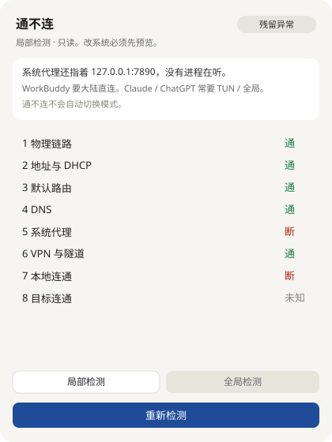
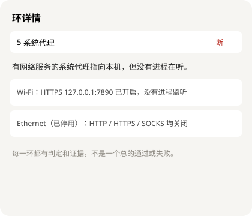
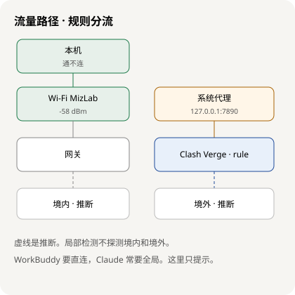
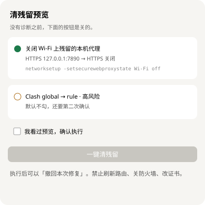
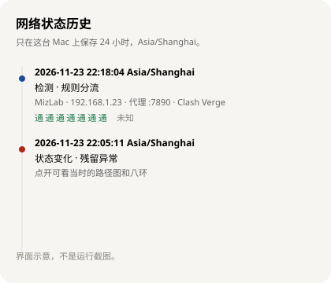

# 通不连

通不连是一个驻留在 macOS 菜单栏里的网络诊断工具。它沿着一条固定的八环链路看这台 Mac 现在是怎么上网的：物理链路、地址、路由、DNS、系统代理、VPN / 隧道、本机端口，以及可选的目标探测。每一环单独给出 **通 / 断 / 部分 / 未知**，并附上证据。

它只在你看过预览并明确确认之后，才会改系统。默认什么都不改。

英文包名是 Tongbulian，诊断核心的模块名是 TongDuan。

## 它不是什么

- 不是代理客户端，也不是规则编辑器。这里没有节点列表，没有 Clash / Surge 规则编辑，也不会导入订阅。
- 不复制其他代理图形界面的布局、图标或说明文字。
- 不会在后台把代理模式从全局改成规则，或从规则改成全局。WorkBuddy 需要大陆直连，Claude / ChatGPT 往往更希望走 TUN / 全局。通不连把这个冲突写出来，然后停住。
- 不把 `ping 1.1.1.1` 当成「这台 Mac 在线」的证明。校园网和一些中间设备会让这个探测说谎。

## 功能

- 菜单栏常驻，窗口大约 420 点宽。五个页面：总览、环详情、流量路径、清残留预览、网络状态历史。界面是中文。
- 八环诊断。局部检测只做前七环，可以离线。全局检测才跑第 8 环。
- 总览底部是检测范围，旁边是主按钮「重新检测」。上次选择会记住，第一次打开默认是局部检测。
- 根据本机信号判断路径模型，并画出方框和连线。推断出来的边用虚线标出。每次重新检测都重画。
- 修复针对失败的那一环：清掉指向本机但已经没人听的代理或 DNS、在网卡还活着时续租 DHCP、断开一个已连接的系统 VPN（不删除描述文件）、只在 Clash 的 API 已经听在 `127.0.0.1` 上时，才提议把 `global` 改成 `rule`。
- 修复前给出「现在 → 改成」。安全项默认勾上，高风险项默认不勾，还要第二次确认。确认框一开始是空的。
- 修复前做快照。做完可以「撤回本次修复」，然后重新检测，并排看修复前和修复后的路径图。
- 24 小时网络状态历史只存在这台 Mac 上。

## 界面

下面是界面示意，不是运行截图。菜单栏应用要在 Mac 上编译后才能截到真窗口。

| 总览 | 环详情 |
| --- | --- |
|  |  |

| 流量路径 | 清残留预览 |
| --- | --- |
|  |  |



总览把八环排开，每环一行判定。环详情展开这一环的原始证据。流量路径是方框和连线，虚线表示推断。清残留预览里，按钮在没有诊断、没有勾选确认之前是灰的。历史按上海时间排成一条瀑布，点开某一笔可以看到当时的图和八环。

## 局部检测和全局检测

检测范围放在总览底部，「重新检测」的旁边。

- **局部检测**只做第 1 环到第 7 环。读本机命令、探测局域网网关、核对 `127.0.0.1` 上该听的端口。不访问 baidu，也不访问境外地址。第 8 环保持 **未知**，并写明这是信息缺口。
- **全局检测**在上面之外，再做第 8 环的对照探测。

选择写在用户默认设置里，下次打开还是这个范围。应用开着的时候，后台每 5 分钟做一次局部采样，用来写历史。这次采样不访问公网，也不会把你上一次全局检测的窗口悄悄换成另一套结论，除非本机状态本身变了。

## 八环

| 环 | 看什么 |
| --- | --- |
| 1 物理链路 | Wi-Fi 是否关联、信号、以太网是否有地址 |
| 2 地址与 DHCP | IPv4、DHCP / 手动、169.254 链路本地地址 |
| 3 默认路由 | 有没有 default，走的是物理网卡还是 utun，是不是有好几条 |
| 4 DNS | 系统解析器，以及指到 `127.0.0.1` 的劫持。有进程在听和没人听，结论不一样 |
| 5 系统代理 | 每个网络服务的 HTTP、HTTPS、SOCKS、PAC、WPAD。停用的服务如果还留着代理，也会写出来 |
| 6 VPN 与隧道 | Clash、Clash Verge / verge-mihomo、Surge、WireGuard、sing-box、V2Ray / Xray、Tailscale、AnyConnect、aTrust、OpenVPN、系统 VPN、utun、拆分隧道 |
| 7 本地连通 | 网关是否应答，配置过的本机代理端口是否还在听 |
| 8 目标连通 | 可选。见下一节 |

证据不够时，这一环是 **未知** 或 **部分**，并带「信息缺口」或「推断」。不会为了填满表格编一个结论。

## 第 8 环怎样区分三种失败

全局检测把四件事放在一起看：

1. 网关能不能达
2. 绕过代理的境内 HTTPS（例如 baidu）
3. 绑定物理网卡的境外 443（`1.1.1.1:443`）
4. 同一个境外目标，走本机代理或当前隧道再测一次

`ping 1.1.1.1` 会另记一笔。它成功，不能说整台 Mac 在线；它失败，也只说明这一次探测失败。

三种要分开的失败：

- **已经连上 Wi-Fi 或以太网，但网关不通；或者网关是通的，绕过代理的境内直连仍然失败。** 这是本地链路或当前 Wi-Fi 的上游没网，不是代理地址写错。
- **境内直连是通的，本地客户端和端口也正常，但走隧道或代理访问境外目标失败。** 更像 VPN、节点或境外一侧不通，不是「本地代理没配置」。
- **系统代理或 DNS 还指着 `127.0.0.1`，但没有进程在听；或者隧道进程已经不在，utun 路由还留着。** 这是本地残留。

第 8 环的判定用这几个名字：未探测、本地链路或当前 Wi-Fi 上游没网、VPN 或境外路径不通、本地残留或配置错误、仅探测失败、信息缺口、目标连通正常。

局部检测即使夹具里带了外部探测结果，第 8 环也保持未知。范围说了不测，就不会偷偷用这些结果下结论。

## 路径模型

八环的清单是固定的，流量实际怎么走不是。通不连用 `networksetup`、`scutil`、路由表、进程、监听端口，以及已经开在本机的 Clash API 来归类。至少包括：

| 模型 | 什么时候 |
| --- | --- |
| 直连干净 | 没有系统代理，没有接管默认路由的隧道，也没有残留的 `127.0.0.1` |
| 系统代理 | 系统代理开着，默认路由仍在物理网卡。读不到规则时，不把它说成规则分流 |
| TUN/全局 | 默认路由进了 utun，或 Clash 处于 `global`，或 TUN 已打开 |
| 规则分流 | Clash 的 API 说是 `rule`，或 Surge / sing-box 在跑，而且默认路由还在物理网卡 |
| 拆分隧道 | Tailscale、AnyConnect、aTrust 等在线，但没有拿走默认路由 |
| 残留异常 | 本机代理或 DNS 指向没人听的端口，或 utun 还在而客户端已经退出 |
| 校园混合 | SSID 或 WPAD 像校园网，同时又叠了代理或隧道 |

Clash 的模式只有在 `http://127.0.0.1:<port>/configs` 已经返回内容时才采用。接口不在本机、或者返回拒绝，就当成不知道，不会去翻配置文件，也不会猜密钥。

图每次重画。没有实际测过的边标成推断。局部检测里，通向境内和境外的边都是推断。

## 24 小时历史

页面叫「网络状态历史」。文件在：

```text
~/Library/Application Support/Tongbulian/history.json
```

没有账号，没有上传。超过 24 小时的记录在下次读写时删掉。时间用 `Asia/Shanghai` 显示。

会记一笔的时机：

- 每一次手动检测
- 应用开着时，每 5 分钟一次局部采样。和上一笔相比，链路、地址、网关、DNS、系统代理、客户端、路径模型或前七环有变化，记为「状态变化」，否则记为「定时记录」

每一笔包含：时间、Wi-Fi / 以太网是否连上、SSID（读得到的话）、IP、网关、DNS、系统代理开关和端口、VPN 或客户端的名字、隧道地址、路径模型、八环判定，以及当时的路径图。点开时间线上的一点，可以看到那张图和各环结果。

没有定位权限时，SSID 可能是空的。历史里会写成未知，其余字段照旧。

## 修复、预览、撤回

诊断做完之前，「一键清残留」是关的。做完之后，计划按失败的环来，而不是把所有能改的开关都列出来。

| 情况 | 提议 | 默认 |
| --- | --- | --- |
| 系统代理指着 `127.0.0.1`，端口没人听 | 关掉这个服务上的 HTTP / HTTPS / SOCKS | 勾选，仍要确认 |
| DNS 指着 `127.0.0.1:53`，没人听 | 清空，改回 DHCP 分配的 DNS | 勾选，仍要确认 |
| 网卡还关联着，但只有 169.254 或 DHCP 没拿到地址 | `ipconfig set enX DHCP` | 勾选，仍要确认 |
| 残留的是本机 PAC | 关掉 PAC | 本机 URL 默认可勾；外部 URL 算高风险 |
| WPAD 和残留叠在一起 | 关掉 WPAD | 不勾，高风险 |
| 系统 VPN 已连接，且第 8 环是境外路径不通 | `scutil --nc stop`，不删除描述文件 | 不勾，高风险 |
| Clash API 在 `127.0.0.1`，模式是 global，且境外路径不通 | `PATCH /configs`，把 mode 改成 rule | 不勾，高风险 |
| utun 路由还在，但没有可断开的系统 VPN | 只提示。不执行 `route flush` | 不能勾 |

每一项都写成「现在的值 → 新的值」，并给出将要执行的那条允许列表命令，方便你对。

确认框默认不勾。勾了高风险项之后，还要再勾一次。两个框都满足，「一键清残留」才会亮。执行时系统弹出管理员密码对话框，密码不经过通不连的窗口。

执行前把当前代理、DNS、PAC、WPAD、已连接的系统 VPN 名字、Clash 模式记成快照。成功后可以「撤回本次修复」：代理主机和端口必须和快照里的完全一致，不会在撤回时填进一个新地址。DHCP 续租没有旧租约可以自动还原，撤回说明里会写明。撤回之后再检测一次，修复前和修复后的图都留在这个页面上。

Clash 一切正常时，不会因为它处在 global 就提议改模式。

## 安全模型

修复不是「界面上写了禁止」而已。能执行的动作是一个类型化的允许列表。任意拼接出来的 shell 字符串一律拒绝，包括看起来无害的那句 `networksetup -setwebproxystate … off`。只有经过校验的命令对象才会变成参数数组。

允许的只有：

- 关闭（或按快照重新打开）某个网络服务上已经存在的 Web / HTTPS / SOCKS / PAC / WPAD
- 把该服务的 DNS 设回空，或设回快照里的那些地址
- 对 `en*` / `bridge*` 做 DHCP 续租
- `scutil --nc stop` 一个系统 VPN；`start` 只在撤回时、且快照里它当时是连接着的
- 按快照写回原来的代理主机和端口
- 对 `127.0.0.1` 或 `localhost` 上的 Clash API 发 `PATCH`。修复阶段只允许把模式设为 `rule`；撤回时只允许设回快照里的 `rule` / `global` / `direct`

下面这些构造不出来，校验也会拒绝：

- 关闭防火墙（`socketfilterfw`、`pfctl`）
- 改证书信任、动钥匙串
- 改 `/etc/hosts`
- `route -n flush` 或任何 `route flush`
- 删除 VPN 描述文件、`networksetup -removepreferred`、卸载客户端
- 在修复阶段设置一个新的代理服务器
- 把流量指到快照里没有的代理

服务名、接口名、VPN 名里如果带有 shell 元字符，整条命令拒绝。

干跑和诊断路径不调用修复器。

## 权限

| 需要 | 用来做什么 | 不需要时 |
| --- | --- | --- |
| 管理员密码 | 真正改网络设置时，由系统对话框询问 | 只检测、只预览，不需要 |
| 定位 | 只为读取当前 Wi-Fi 的名字（SSID） | 拒绝后诊断继续，SSID 记为未知 |
| 网络 | 全局检测的第 8 环，以及本机回环上的 Clash API | 局部检测不访问公网 |

不请求完全磁盘访问权限，不请求辅助功能。不读钥匙串，不扫描家里目录里的代理配置文件。

定位文案写在应用的 `Info.plist` 里。用 `swift run` 直接跑可执行文件时，系统不一定带上这段文案，SSID 可能读不到。要用菜单栏应用和定位提示，请走下面的 `build-app.sh`。

## 环境要求

- 菜单栏应用：macOS 13 或更新，Xcode 15 或更新（Swift 5.9 以上）
- 诊断核心和单元测试：有 Swift 工具链即可，Linux 上也能跑
- 不依赖网络才能完成第 1–7 环。第 8 环才需要出网

## 构建和运行

```bash
git clone https://github.com/NNNoxin/Tongbulian.git
cd Tongbulian

swift test
swift run tongbulian diagnose --demo leftover
swift run tongbulian diagnose --demo upstream --scope global

# 只在 macOS 上：
swift run TongbulianApp
./scripts/build-app.sh
open dist/通不连.app
```

`swift test` 跑诊断核心。夹具是代码里的命令输出，不需要真的 Mac 网络。

`tongbulian diagnose` 是干跑。它打印八环表格，不修改代理、DNS、路由或 VPN。示例名：

```text
clean, proxy, leftover, upstream, foreign, wifi-off, tun, rule
```

也可以把采集结果存成 JSON，用 `--fixture 文件` 再跑一遍。字段缺了就按空处理。在 Linux 上不带 `--demo` 或 `--fixture` 的 `--dry-run` 会说明本机没有 macOS 采集器，然后退出，仍然什么都不改。

`./scripts/build-app.sh` 在 macOS 上生成 `dist/通不连.app`，并用本机临时签名。图标源文件是 `packaging/AppIcon-1024.png`（海军蓝底、三段薄荷绿实心节点、最后一环珊瑚空心圈）。脚本用 `sips` 和 `iconutil` 做成 `AppIcon.icns`，放进 `Contents/Resources`，`Info.plist` 的 `CFBundleIconFile` 指向它，然后再签名。Finder、启动台和「应用程序」里因此显示这枚图标，而不是空白方块。在 Linux 上脚本会直接退出并说明打不出 `.app`，PNG 仍留在仓库里。这个包没有经过 Apple 公证。

第一次打开：

1. 在 Finder 里对「通不连」按住 Control 再点，选「打开」。
2. 如果系统仍然拦截，到「系统设置 → 隐私与安全性」，点「仍要打开」。
3. 菜单栏出现「通不连」。点它打开窗口。
4. 若要 SSID，允许定位。这一步可以拒绝。
5. 先做局部检测。需要第 8 环时再切到全局检测。

在 Xcode 里可以直接打开 `Package.swift`。应用目标 `TongbulianApp` 只在 macOS 上加入包描述；Linux 上解析这个包时不会去编译 SwiftUI。

## 离线

拔掉网线、关掉 Wi-Fi，或者根本没有默认路由，局部检测仍然能做完前七环：没关联就是没关联，没有 DHCP 地址就是没有，没有默认路由就是没有。第 8 环保持未知。

不要用全局检测来判断「我是不是完全离线」。全局检测要发出探测；探测发不出去，只能说明这些探测失败。

## 常见问题

**检测会不会改我的代理？**  
不会。只有清残留页面里，确认框勾上并且按钮可点之后，才会改。

**为什么第 8 环是未知？**  
范围是局部检测，或者全局检测没有拿到足够的对照。信息缺口会写在这一环下面。

**baidu 不通，是不是代理写错了？**  
先看第 8 环的判定。网关不通，或网关通但绕过代理的境内直连也失败，归到链路或 Wi-Fi 上游，不归到代理笔误。

**Clash 开着，境外网站打不开。**  
如果境内直连是通的，本地端口也在听，而走代理的那一次失败，判定是境外路径或节点，不是「你没配代理」。

**可以帮我把防火墙关掉吗？**  
不能。允许列表里没有这条命令。

**历史会同步到 iCloud 吗？**  
不会。文件在本机的「应用程序支持」目录，24 小时后删。

**两个代理一起开着会怎样？**  
第 6 环标成部分，证据里列出名字。通不连不替你退掉其中一个。

**Tailscale 开着，但上网还是直连？**  
默认路由如果仍在物理网卡，路径模型是拆分隧道，不是 TUN/全局。

## 架构

```text
TongDuanCore          解析、八环、路径、图、修复允许列表、历史、干跑文本
tongbulian            命令行。只调用诊断，不调用修复执行器
TongbulianApp         macOS 菜单栏。采集、SwiftUI、真正执行允许列表
```

采集器把 `networksetup`、`scutil`、`route`、`netstat`、`ifconfig`、`lsof`、`ps` 的原文放进 `ProbeBundle`。分类器只看这个结构，所以测试可以用真实形态的命令输出，而不去碰当前机器的网络。

Mac 上的采集器在局部检测里会 ping 网关。全局检测再增加：绑定物理网卡访问 `https://www.baidu.com`（`--noproxy *`）、`nc` 到 `1.1.1.1:443`、以及经本机代理或默认路由再测同一个 `1.1.1.1`。`ping 1.1.1.1` 单独记录。

修复执行器先对每条命令做允许列表校验，再把通过的参数数组合并成一次系统对话框。Clash 的请求单独发往回环地址，不进 shell。

## 测试

在 Linux 和 Mac 上：

```bash
swift test
```

当前套件覆盖这些分类，而不是只测一个总开关：代理开着且端口在听、代理残留、DNS 残留、没有默认路由、没有 DNS、utun / TUN 和规则模式、Wi-Fi 关闭、外部探测失败但不能说成整机离线、`ping 1.1.1.1` 成功也不能说成在线，以及第 8 环的三种失败（上游、境外路径、残留 / 陈旧 utun）。另有允许列表、撤回、24 小时裁剪、上海时区和干跑文本的测试。本次在 Linux 上 `swift test` 为 62 项通过。

## 这次仓库里没有的东西

菜单栏应用的源码在仓库里，可以在 Mac 上构建。写这份代码的环境是 Linux，没有 SwiftUI SDK，也没有可用的 Mac 构建池，所以这里没有附带编好的 `.app`，也没有对应用做临时签名之外的公证。请在自己的 Mac 上运行 `./scripts/build-app.sh`。

## 许可

[MIT](LICENSE)。Copyright (c) 2026 NNNoxin.

## English

Tongbulian is a macOS menu-bar utility that diagnoses VPN, system-proxy, and leftover network state. Eight hops each return 通 / 断 / 部分 / 未知 with evidence. Local scope is offline and leaves hop 8 unknown. Global scope compares gateway reachability, direct domestic HTTPS, direct foreign port 443, and the same foreign target through the local proxy or tunnel. Ping of 1.1.1.1 is recorded and is never treated as proof the Mac is online.

Repairs are previewed, unchecked until you confirm, and limited to an allowlist. The app will not disable the firewall, change certificate trust, edit `/etc/hosts` or the Keychain, flush the routing table, delete VPN profiles, or point you at a new proxy. A snapshot can roll back the last repair. A 24-hour history stays on the Mac.

Build the core anywhere Swift runs (`swift test`, `swift run tongbulian diagnose --demo leftover`). Build the menu-bar app on macOS 13+ with Xcode: `./scripts/build-app.sh`. That script turns `packaging/AppIcon-1024.png` into `AppIcon.icns` and points `CFBundleIconFile` at it before the ad-hoc signature.
